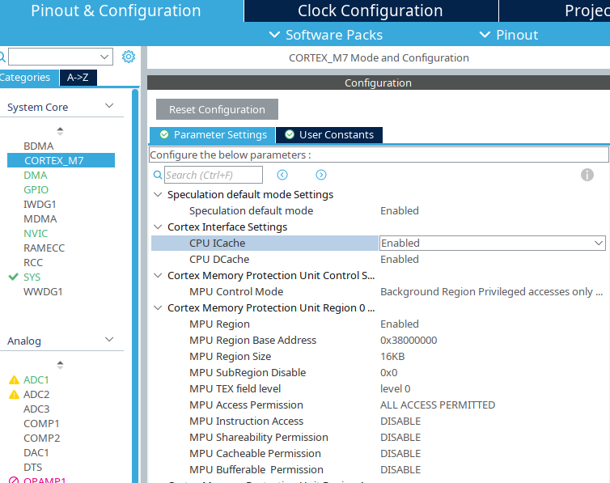
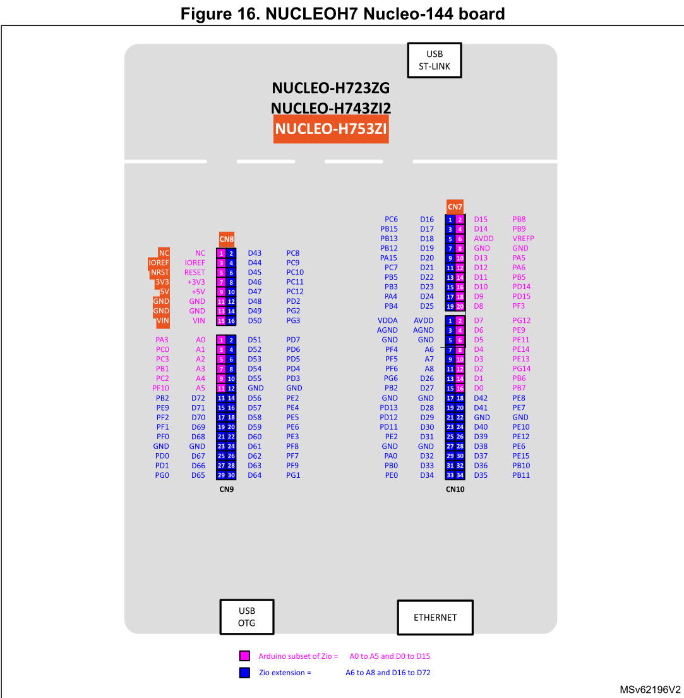

# STM32H7 ThreadX Motor Controller

## Project Overview
A multi-threaded **ThreadX** application running on the **STM32H7 series** to control multiple servo and stepper motors.

## Technical Requirements
* **Toolchain:** Must use the **Makefile toolchain** for compatibility with the VS Code STM32 extension.
* **Base Code:** Modified from the ST `Tx_Thread_Creation` CubeMX example.
* **Flashing:** Requires **OpenOCD >0.12** with ST-Link support.

Manual flash command:
```bash
openocd -f openocd.cfg -c "program Tx_Thread_Creation.elf verify reset exit"
```

---

## 🛠️ Adding a New Task
To prevent CubeMX from overwriting your custom code during regeneration, follow this architecture:

1. **Protect Source Code:** Write custom `main.c` code *only* inside explicit `/* USER CODE BEGIN */` and `/* USER CODE END */` blocks.
2. **Declare:** Add your function prototype `CallThreadXX` in `main.h`.
3. **Isolate Logic:** Implement the heavy task functions in a dedicated `tasks.c` file to keep `main.c` clean.
4. **Register Thread:** In `app_threadx.c`, initialize the thread using `tx_thread_create()`. Define the thread's function pointer and set up a callback pointing back to `main.c`.
5. **Bridge Callback:** Implement the callback function in `main.c` to pass parameters and invoke the target function in `tasks.c`.

---

## 📊 ADC Configuration
* **Mode:** Multi-channel Scan Mode operating in **Circular Mode** (`HAL_ADC_Start` is called once).
* **Sampling:** ADC1 samples two channels simultaneously.
* **Trigger:** Hardware conversions are triggered automatically every 100 ms (10 Hz) by the **Timer 2 Trigger Out (TRGO)** event.

---

## 🧠 D-Cache & Non-Cacheable Memory Setup
Because the Cortex-M7 uses data caching, the ADC DMA buffer must reside in a **non-cacheable memory area** to prevent data corruption.

### Linker Script Modification (`STM32H723GTx_FLASH.ld`)
Map a custom `.nocache` section directly into the unreserved **RAM_D3** memory region:

```linker-script
/* RAM MODIFICATION: NON-CACHEABLE AREA FOR ADC BUFFER */
.nocache (NOLOAD) :
{
    . = ALIGN(16);
    *(.nocache)
} > RAM_D3
```

### Code Declaration
Use attributes to force the array into the non-cacheable section, and mark it `volatile` to stop compiler optimization bypasses:

```c
volatile uint16_t ADC_BUF[2] __attribute__((section(".nocache")));
```

### CubeMX Settings
Ensure Instruction (I) and Data (D) caches are enabled with MPU settings matching your memory regions:



---

## 📌 Pin Layout



---

## 💻 Useful Git commands

**Force Sync with Remote (Discard local changes completely):**
```bash
git fetch origin
git reset --hard origin/main
```

**Force Push to Remote (Overwrite remote history/conflicts):**
```bash
git push --force origin
```
